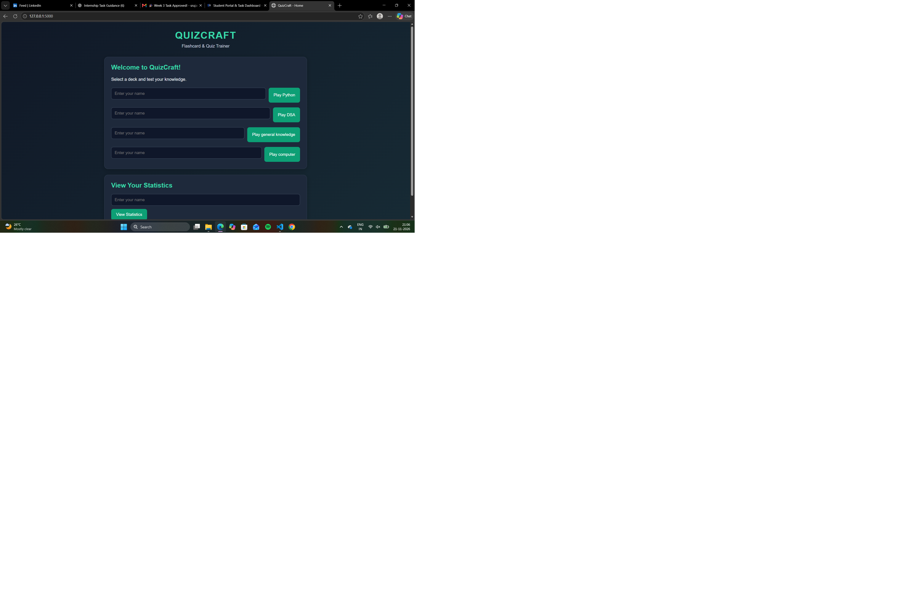
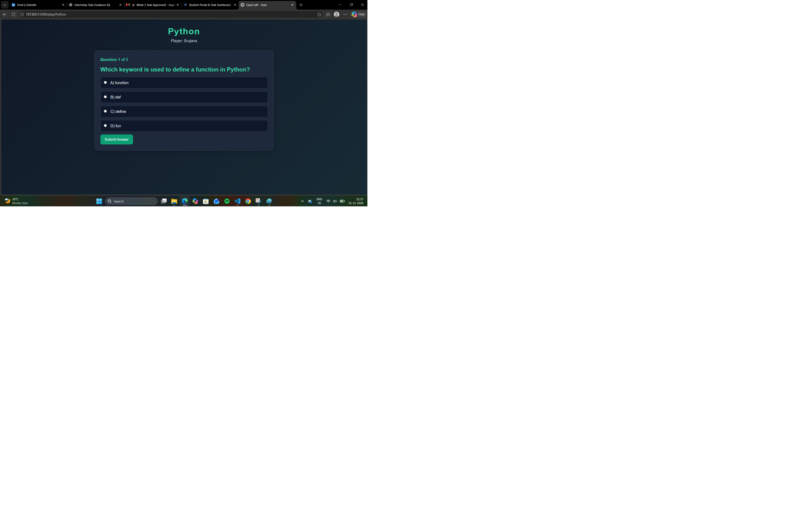

# QuizCraft – Python Quiz Trainer

## About the Project

QuizCraft is a Python-based quiz application that allows users to practice quiz questions, organize questions into different decks, track their performance, and save their progress.

The application includes both a terminal-based quiz system and a web-based quiz interface built using Flask.

This project is developed as part of the SkillMe Python Internship and is completed in four weekly stages.

## Features

### Week 1 – Terminal Quiz from a Text File

- Loads questions from `questions.txt`.
- Supports multiple quiz questions.
- Randomizes the order of questions.
- Checks answers without case sensitivity.
- Displays correct answers for incorrect responses.
- Shows final score, percentage, and wrong answers.
- Allows users to play multiple rounds.
- Handles invalid user input.
- Includes automated tests using pytest.

### Week 2 – Decks, Classes and Saved Progress

- Organizes questions into different quiz decks, such as Python and DSA.
- Uses Python classes: `Question`, `Deck`, and `QuizSession`.
- Supports multiple-choice questions with A, B, C, and D options.
- Allows players to choose a quiz deck.
- Saves each player's quiz results in `progress.json`.
- Tracks the number of attempts and best score for each deck.
- Maintains separate progress for different players.
- Automatically creates progress storage when results are first saved.
- Displays a menu to play quizzes, view statistics, or exit.

### Week 3 – Import Questions from a Free API

- Integrates the Open Trivia Database (OpenTDB) API to fetch online quiz questions.
- Allows players to select quiz categories such as General Knowledge, Science & Nature, Computers, Mathematics, Sports, History, and Geography.
- Supports Easy, Medium, and Hard difficulty levels.
- Allows players to choose the number of questions (5–10).
- Converts API responses into the existing multiple-choice question format.
- Decodes HTML entities in fetched questions and answers.
- Randomizes answer choices.
- Uses the existing `QuizSession` class to conduct online quizzes.
- Handles API errors, connection failures, and request timeouts.
- Automatically provides local quiz decks when the API is unavailable.
- Allows players to save fetched online questions as new local decks for offline practice.
- Saves online and offline quiz results in player progress.

### Week 4 – Web Quiz with Flask and Tests

- Develops a web-based quiz application using Flask.
- Displays available quiz decks on the home page.
- Allows players to enter their name and start a quiz.
- Displays multiple-choice and text-based questions through web pages.
- Uses Flask sessions to maintain quiz progress.
- Tracks the current question, score, player, and selected deck.
- Displays the final score, percentage, and incorrect answers.
- Saves quiz results to the existing progress storage.
- Provides a statistics page showing attempts and best scores for each deck.
- Prevents page refreshes from submitting the same answer again.
- Prevents completed quiz results from being saved more than once.
- Includes automated Flask application tests using pytest.

## Project Structure

```text
QuizCraft-Python-Internship/
│
├── quiz.py
├── questions.txt
├── test_quiz.py
│
├── api.py
├── models.py
├── storage.py
├── main.py
│
├── app.py
├── test_app.py
├── requirements.txt
│
├── templates/
│   ├── index.html
│   ├── quiz.html
│   ├── results.html
│   └── stats.html
│
├── static/
│   └── style.css
│
├── screenshots/
│   ├── home.png
│   ├── quiz.png
│   ├── results.png
│   └── stats.png
│
├── decks.json
├── progress.json       # Automatically generated; not committed
│
├── .gitignore
└── README.md
```

## Requirements

- Python 3.x
- Flask
- Requests
- Pytest

## Installation

Clone the repository:

```bash
git clone https://github.com/srujanasirim-ux/QuizCraft-Python-Internship.git
```

Navigate to the project directory:

```bash
cd QuizCraft-Python-Internship
```

Install the required libraries:

```bash
python -m pip install -r requirements.txt
```

## How to Run

### Week 1 – Terminal Quiz

Run:

```bash
python quiz.py
```

Enter the number of questions you want to attempt, answer the questions, and view your final score.

### Week 2 and Week 3 – QuizCraft Terminal Application

Run:

```bash
python main.py
```

Enter your player name and choose an option from the main menu:

1. Play Local Quiz
2. Online Quiz
3. View Statistics
4. Exit

**Play Local Quiz:**

- Select an available quiz deck.
- Answer multiple-choice questions.
- View your final score.
- Your progress is automatically saved.

**Online Quiz:**

- Select a category.
- Choose a difficulty level.
- Select the number of questions.
- Answer the fetched questions.
- Optionally save the questions as a new local deck.

If the API is unavailable, QuizCraft automatically switches to local quiz decks so players can continue practicing.

### Week 4 – Flask Web Application

Run the Flask application:

```bash
python -m flask --app app run
```

Open the following address in your browser:

```text
http://127.0.0.1:5000
```

**Using the Web Application:**

1. Enter your player name.
2. Select a quiz deck.
3. Answer the questions displayed on the web page.
4. View your final score and incorrect answers.
5. Visit the statistics page to view your attempts and best scores.

The application uses Flask sessions to maintain quiz progress and prevent duplicate result submissions when refreshing the results page.

## How to Add Questions

### Week 1

Open `questions.txt` and add questions using this format:

```text
Question|Answer
```

Example:

```text
What is the extension of a Python file?|.py
Which keyword defines a function in Python?|def
```

Make sure each question and answer is separated by the `|` symbol.

### Week 2 and Week 3

Open `decks.json` and add questions to an existing deck or create a new deck.

Each question contains:

- `text` – The question.
- `answer` – The correct answer option.
- `choices` – Multiple-choice options.

Online questions can also be saved directly as new local decks through the application.

## Screenshots

Screenshots of the Week 4 Flask web application:

### Home Page


### Quiz Page


### Results Page


### Statistics Page


## Technologies Used

- Python
- Flask
- HTML
- CSS
- Open Trivia Database API
- REST API Integration
- Requests Library
- JSON
- File Handling
- Object-Oriented Programming (OOP)
- Classes and Methods
- Flask Sessions
- Jinja2 Templates
- Exception Handling
- Random Module
- HTML Entity Decoding
- Pytest

## Testing

Run all automated tests using:

```bash
python -m pytest -v
```

The project includes tests for:

**Week 1:**
- Loading questions from a text file.
- Handling invalid question lines.
- Handling missing files.

**Week 4:**
- Loading the home page.
- Starting a quiz.
- Checking correct answers and scoring.
- Ensuring quiz results are saved only once.
- Displaying the statistics page.

The current test suite contains 8 passing tests.

Week 2 and Week 3 features were also tested manually, including:

- Playing local quiz decks.
- Saving and retrieving player progress.
- Viewing quiz statistics.
- Fetching online questions using different categories and difficulty levels.
- Saving online questions as local decks.
- Playing saved decks offline.
- Testing API connection failure and local fallback.

## Learning Outcomes

Through this project, I practiced:

- Python functions and modular programming.
- File handling and exception handling.
- User input validation.
- Object-Oriented Programming.
- Creating and using Python classes.
- Reading and writing JSON files.
- Saving and retrieving player progress.
- Working with REST APIs.
- Sending HTTP requests using the Requests library.
- Handling API responses and network errors.
- Building web applications using Flask.
- Creating HTML templates and styling web pages with CSS.
- Managing user sessions using Flask.
- Implementing automated tests using pytest.
- Preventing duplicate form submissions and result storage.

## Internship

**SkillMe – Python Virtual Internship**

- Week 1: Terminal Quiz from a Text File.
- Week 2: Decks, Classes and Saved Progress.
- Week 3: Import Questions from a Free API.
- Week 4: Web Quiz with Flask and Tests.

**Project:** QuizCraft – Python Quiz Trainer
